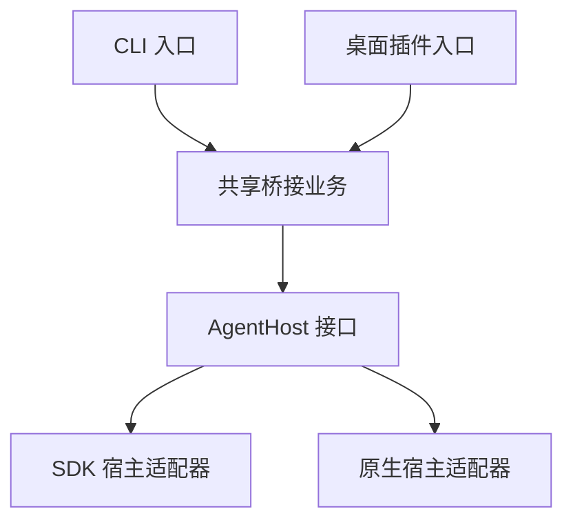

# 钉钉与 DSH 聊天桥接

将机器人单聊、群聊映射到 DSH 会话。业务层共用消息去重、SQLite 队列、会话映射、回复分段和发送重试，通过组合入口选择 Agent 宿主。

**一次只运行一种模式。** 每个实例只注入一个宿主，不提供进程内的模式切换、多宿主注册表或双模式并存。切换模式时先停止旧入口，再启动新入口；同一个机器人不要同时连接两个入口。

## 两种入口

| 项目 | CLI 独立服务 | 桌面插件 |
| --- | --- | --- |
| 入口 | `src/main.ts`，执行 `npm.cmd start` | `src/plugin.ts`，由桌面 Host 加载 |
| 宿主适配器 | `SdkAgentHost` | `NativeAgentHost` |
| DSH 运行环境 | SDK 按需启动独立子进程 | 使用官方桌面客户端的现有 Host |
| 模型与凭证 | 环境文件中的 DeepSeek API 配置 | 桌面端的默认模型及现有凭证 |
| 会话与活动 | 由独立 SDK 运行时保存 | 原生会话进入 GUI 工作区，活动由 GUI 展示 |
| 权限和交互 | 固定工作区写入，拒绝额外审批，取消交互提问 | 沿用桌面端的权限与交互机制 |
| 默认 mapping | `.data/bridge.sqlite` | DSH 用户数据目录下的 `dingtalk-dsh/desktop/bridge.sqlite` |
| 退出 | 关闭 SDK 子进程 | 仅停止桥接，保留桌面 Host 和会话 |

每种模式使用新的 mapping 数据库。切回 CLI 时继续使用原有数据库和会话；桌面模式从自己的新映射开始。程序记录数据库所属模式，若误用另一模式的数据库会拒绝启动，不会混用或自动迁移历史。

## 环境准备

1. 开发和 CLI 模式使用 Node.js 24 LTS，最低 `24.13.0`，数据库使用内置 SQLite。
2. 在钉钉开发者后台创建企业内部应用，启用机器人能力，选择 **Stream 模式**，配置可使用范围并发布版本。
3. 准备 Client ID 和 Client Secret。CLI 额外需要 DeepSeek 官方 API Key；桌面模式先在桌面客户端配置好可用模型。

当前 DSH 接口适配和开发依赖固定在 `0.2.2-rc.1`。桌面插件需要 `sessionController`、`workspaceRegistry` 和 `credentials` 服务。更早版本或第三方 GUI 需要单独核对兼容性。

## CLI 独立服务

在仓库根目录打开 PowerShell：

```powershell
npm.cmd ci
Copy-Item .env.example .env
```

已有 `.env` 时保留现有文件。填写 `DINGTALK_CLIENT_ID`、`DINGTALK_CLIENT_SECRET`、`DEEPSEEK_API_KEY` 后执行：

```powershell
npm.cmd run build
npm.cmd start
```

出现“钉钉连接已建立”后发送消息；DSH 在第一条任务到达时启动。保持终端与机器运行，`Ctrl+C` 停止服务。此入口完整安装开发依赖，其中包含可选运行时 SDK；不要用省略开发依赖的安装方式部署该源码入口。

已有 CLI 部署可以继续使用原有环境文件、会话映射和 SDK 会话。源码更新后重新构建，再重启服务。

## 桌面插件

先停止 CLI 独立服务。首次安装时，钉钉桥接默认关闭。

### 构建和安装

在本程序目录执行：

```powershell
npm.cmd ci
npm.cmd run pack:plugin
```

生成 `dingtalk-dsh-0.2.14.tgz`。在 DSH 桌面客户端打开「插件 → 添加插件」，输入安装包的完整路径，安装后启用插件。也可以在完全退出桌面客户端后，使用**桌面程序提供的 dsh 命令**安装或升级。

```powershell
$pluginPackage = (Resolve-Path ./dingtalk-dsh-0.2.14.tgz).Path
dsh plugin --profile desktop add $pluginPackage
```

桌面命令可通过应用菜单的“管理 dsh 命令…”安装。安装命令后打开新终端，并用 `dsh --version` 检查版本。Windows 可从系统托盘的右键菜单完全退出桌面客户端。

### 本机配置

1. 打开桌面客户端，进入「插件」，点击「已安装插件」下的 `dingtalk-dsh` 名称。保持插件本身的开关打开。
2. 从钉钉开放平台应用凭证页复制 Client ID（AppKey）和 Client Secret（AppSecret），分别填写到插件页面，再点「保存配置」。三个可选字段可以留空。
3. 打开详情页内的「启用钉钉桥接」。接着在钉钉私聊机器人，或在群里 @机器人。

首次配置时，「数据目录」默认为 DSH 用户数据目录下的 `dingtalk-dsh/desktop`，「工作区」默认为数据目录下的 `workspace`，「任务超时」默认为 300 秒。可以在页面输入完整目录路径或将超时设为 10 至 3600 秒。

关闭「启用钉钉桥接」会停止 Stream 连接，保留插件配置页、会话和映射。开启状态下保存配置会按新设置重连。开关表示已保存的启用状态，连接建立后宿主会记录“钉钉连接已建立”。

Client Secret 保存在 DSH 的本机凭证库中，详情页只显示保存状态。更换机器人凭证前先关闭桥接，保存新值后再打开。旧版已配置的桥接在升级后继续使用原有映射目录和工作区，在页面保存新凭证后优先使用新凭证。

桥接通过桌面会话服务创建和恢复会话，沿用桌面的模型与智能体预设。工作区 `AGENTS.md` 和技能由该预设按 DSH 的规则加载。已有会话恢复时保留已记录的模型和预设，旧会话缺少预设记录时沿用桌面当前默认预设。

钉钉首次发来消息后，插件在桌面 Host 中创建原生会话，并登记到对应工作区。若该目录已是 GUI 工作区，会复用其名称；否则创建名为“钉钉对话”的工作区。会话的输入、输出及工具事件走桌面原有事件链路。

Agent 空闲时，新消息启动处理。相同 DSH 会话忙碌时，第一条钉钉消息和处理中同一钉钉聊天的后续文字均可用 `steer` 交给 DSH，作为下一步的补充输入。其他钉钉聊天继续排队。

DSH 每提交一条包含正文的助手消息，桥接立即保存并尝试发送正文。Agent 空闲时收尾，异常结束则追加状态提示。「在钉钉发送进度」默认关闭，可在详情页打开，发送开始处理提示和 DSH 任务清单的完成数。单独切换进度开关即时生效。

## CLI 环境变量

进程中已存在的环境变量优先于环境文件。CLI 相对路径以程序目录为基准。

| 变量 | 默认值 | 用途 |
| --- | --- | --- |
| `DINGTALK_CLIENT_ID` | 必填 | 企业内部应用 Client ID，即 AppKey |
| `DINGTALK_CLIENT_SECRET` | 必填 | 企业内部应用 Client Secret，即 AppSecret |
| `BRIDGE_DATA_DIR` | `.data` | CLI 数据根目录 |
| `DSH_WORKSPACE` | 数据目录下的 `workspace` | CLI 会话的工作区 |
| `DSH_RUN_TIMEOUT_MS` | `300000` | 单次任务最长等待时间，允许 10000 至 3600000 毫秒 |
| `DEEPSEEK_API_KEY` | CLI 必填 | 独立运行时的官方 API 密钥 |
| `DSH_MODEL` | `deepseek-flash` | 独立运行时的模型标识 |

## 共享业务行为

- 支持普通文本和仅包含文字的富文本。富文本按顺序合并文字片段，保留原有空格和换行。单聊直接接收，群聊需要 `@机器人`。
- 两种入口都将钉钉正文原样提交给 DSH，并另带回调元数据。桌面把元数据作为同一步骤的上下文记录，CLI 把元数据和正文作为同次 SDK 输入的两个文本块。回调元数据省略临时回复地址、会话凭证及其有效期字段。桥接层使用完整回复地址和有效期投递消息。
- 元数据前的提示告诉 Agent 正文会直接发回当前钉钉聊天。桌面可以在「轨迹」的上下文记录里查看提示。
- 桌面普通消息在气泡上方显示单聊或群聊、群名和发言人，可点击展开元数据。忙时补充消息的上下文可在「轨迹」查看。
- 每个聊天复用一个会话，不同聊天使用不同上下文，同一群内成员共享会话。
- 钉钉聊天的活动全局串行，桌面模式允许同一活动接收补充消息和回传多段正文。CLI 回传最终回答。长回复按 UTF-8 字节数分段。
- 钉钉按每条待发送正文选择消息格式。有标题、加粗、列表等 Markdown 排版时发 Markdown，其余发普通消息。Markdown 的会话预览采用开头的一级或二级标题，其余情况跳过标题并取首行可读正文，最多 40 个字符。
- 收件先写 SQLite 再确认收到，按消息 ID 去重。
- 发送失败只重试已保存的结果，已确认发送的分段不主动重发。
- 重启继续处理尚未执行的队列；执行中断、结果不明的任务只发送提示，不自动重跑。
- 历史会话恢复失败时保留映射，不静默创建空白会话覆盖上下文。

回复使用消息携带的 `sessionWebhook`。过期时保留结果，同一聊天再次收到消息、取得有效地址后补发。全局发送间隔至少 3.2 秒，失败请求退避重试。平台成功接收但响应丢失，或发送成功与写入状态之间退出时，可能出现重复回复；不会因此再次执行 Agent。

SDK 模式超时会关闭其拥有的子进程。桌面模式的等待期限从首条钉钉消息开始执行时起算，超时时取消桥接启动且仍由桥接独自处理的活动。对于桌面已有或用户也参与的工作，超时只结束桥接等待。两种情况下，桌面插件都撤回该活动尚在 DSH 队列中的钉钉输入。取消不会回滚已执行的操作。插件卸载不销毁持久化会话，也不退出桌面 Host。

各聊天共享文件工作区；上下文独立不代表文件隔离。数据目录包含聊天、回复地址和会话映射，应仅授予运行者访问。停止对应入口后再备份数据。环境文件、默认数据目录和安装包均被 Git 忽略。

## 架构和扩展



图中两条入口是两种独立部署方式。一次实例化只传入其中一个适配器：

```typescript
// 独立入口：组合拥有子进程生命周期的宿主。
createBridge(config, new SdkAgentHost(config), logger);

// 插件入口：组合借用桌面服务的宿主。
createBridge(config, new NativeAgentHost(ctx, config.workspace), logger);
```

宿主接口只表达“打开会话、运行输入、释放适配器资源”。钉钉消息、SQLite、发送重试和进程信号不进入宿主接口。新增其他 Agent Host 时，实现 `AgentHost`，再提供一个组合入口即可复用业务层。

```text
src/
  core/host.ts        宿主与会话接口、取消辅助
  core/runner.ts      共享会话路由与任务期限
  core/service.ts     共享收件、串行队列与回复重试
  hosts/sdk.ts        SDK 子进程宿主
  hosts/native.ts     桌面原生宿主
  channels/           隔离钉钉 SDK 的工作线程
  compose.ts          组合共享服务与传入的单一宿主
  config.ts           两种入口的配置解析
  main.ts             CLI 进程入口
  plugin.ts           Cordis 插件入口
  client.js           DSH 桌面插件配置页
```

钉钉 SDK 的底层日志在线程中隔离，桥接只输出固定中文状态。插件不改写全局 `console`，不注册进程退出处理，也不把钉钉凭证注入 DSH 环境。

## 开发检查与验收

安装 Gitleaks 后，在仓库内启用提交前检查。

~~~powershell
git config --local core.hooksPath .githooks
~~~

```powershell
npm.cmd run check
npm.cmd test
```

回归测试使用临时数据库和宿主替身，覆盖共享业务行为、CLI 历史兼容、mapping 分离、两种取消语义，以及插件入口不加载 SDK 等边界，不连接真实账号或更改桌面配置。

在真实钉钉环境中验收时，可以依次检查消息往返、聊天隔离、桌面审批和重启后的会话恢复。

## 接口参考

- [钉钉官方 Stream SDK](https://github.com/open-dingtalk/dingtalk-stream-sdk-nodejs)
- [DSH SDK](https://github.com/deepseek-ai/deepseek-harness/tree/master/packages/sdk/client)
- [DSH 原生 Agent 接口](https://github.com/deepseek-ai/deepseek-harness/tree/master/packages/core/agent)
- [官方桌面插件安装](https://github.com/deepseek-ai/deepseek-harness/tree/master/apps/desktop#bundled-command-runtime)

## 许可

本项目采用 [MIT 许可](LICENSE)。
