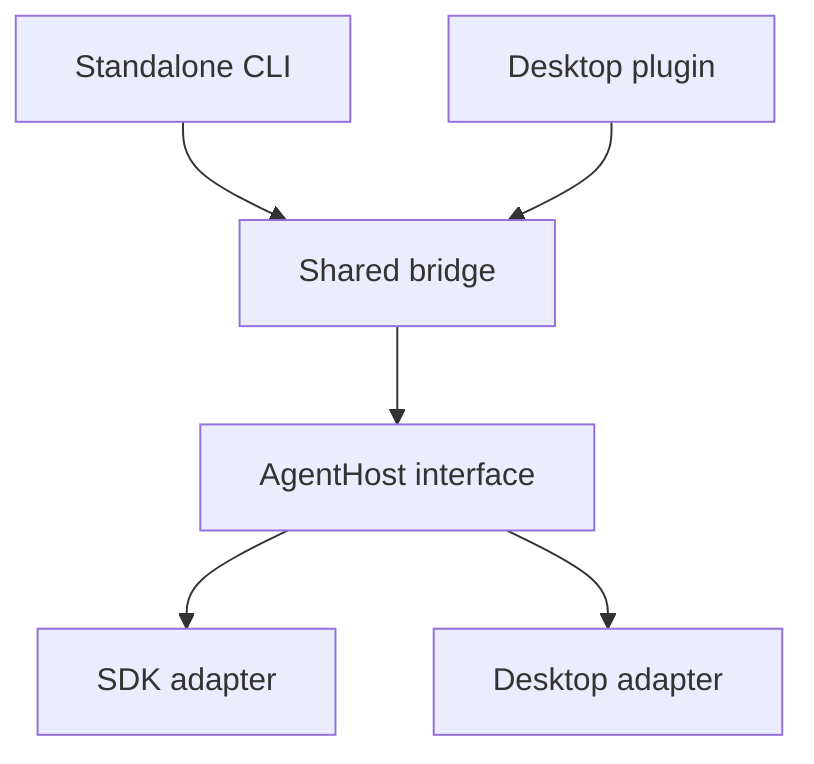

# Architecture

## Deployment Modes

| Mode | Entry point | Host adapter | Runtime ownership |
| --- | --- | --- | --- |
| Standalone CLI | [`src/main.ts`](../src/main.ts) | [`SdkAgentHost`](../src/hosts/sdk.ts) | Starts a separate DSH SDK subprocess on demand and shuts it down when the bridge stops. |
| Desktop plugin | [`src/plugin.ts`](../src/plugin.ts) | [`NativeAgentHost`](../src/hosts/native.ts) | Uses the desktop application's existing host and session services. The plugin owns only its bridge resources. |

The CLI selects its model and API credentials from its own configuration. It permits writes in the configured workspace, denies requests for extra approval, and cancels interactive questions. The desktop plugin inherits the desktop model, credentials, and approval flow.

The DSH development dependencies target `0.2.2-rc.1`. The desktop adapter requires `sessionController` and `workspaceRegistry`, and the plugin uses `credentials` for its DingTalk secret. Check these interfaces when assessing compatibility with other DSH versions or desktop clients.

## Composition

The entry points are alternative deployments. [`createBridge`](../src/compose.ts) receives one [`AgentHost`](../src/core/host.ts) per instance. The host contract opens or restores sessions, runs inputs, and releases resources owned by the adapter. To integrate another host, implement that contract and add an entry point that injects it. Message transport, SQLite, delivery retries, and process signal handling stay outside the contract.

- [`src/core/service.ts`](../src/core/service.ts) coordinates incoming messages, queued tasks, and reply delivery. [`src/core/runner.ts`](../src/core/runner.ts) routes chats to sessions and applies task deadlines.
- [`src/store.ts`](../src/store.ts) persists the SQLite queue and chat-to-session mappings. The store records which deployment owns a database and rejects a mismatched adapter. Existing CLI mappings remain valid.
- [`src/dingtalk.ts`](../src/dingtalk.ts), [`src/messages.ts`](../src/messages.ts), and [`src/channels/dingtalk-worker.ts`](../src/channels/dingtalk-worker.ts) handle DingTalk transport, message parsing, and worker isolation. The desktop plugin leaves the host's process handlers and global `console` alone. It passes DingTalk credentials to the transport without putting them in the DSH environment.

## Message and Session Flow

1. DingTalk sends a Stream callback. The parser accepts plain text and text-only rich messages, preserving fragment order, spaces, and line breaks. The bridge persists accepted messages and deduplicates by message ID within the chat before acknowledging them.
2. The runner reuses the stored session ID for the chat. If restoring it fails, the mapping stays intact. One bridge activity runs at a time. In desktop mode, `steer` can join an already active session or submit follow-up text from the same chat while other chats wait.
3. The bridge passes the original text and sanitized callback metadata to DSH. The SDK uses separate text blocks within one input. The desktop adapter adds the metadata as a context record in the step that consumes the corresponding message. It omits temporary reply URLs, session credentials, and their expiry fields from the metadata passed to DSH.
4. The CLI returns the final answer. The desktop adapter emits completed assistant messages as they arrive and can report task-list progress. The bridge persists reply text before delivery and splits long replies by UTF-8 byte length. The sender chooses plain text or Markdown for each part. Markdown uses an opening level-one or level-two heading for the preview when present, otherwise it uses the first readable body line. The preview is capped at 40 characters.

## Delivery and Recovery

- DingTalk replies use the chat's `sessionWebhook`. The bridge spaces sends at least 3.2 seconds apart and retries failed deliveries with backoff. If the reply URL expires, it keeps the result until another message in the same chat provides a valid URL.
- Retries use the stored reply and continue with the first unconfirmed part. If the platform receives a reply but its response is lost, or the bridge exits before recording a successful send, a part can be sent again without rerunning the Agent.
- After restart, the bridge resumes queued work. It records a notice for an interrupted activity whose outcome is unknown and leaves its execution for the user to assess.

## Timeouts and Shutdown

The CLI adapter shuts down its SDK subprocess on timeout. In desktop mode, the deadline starts when the bridge begins processing the first DingTalk message in an activity. The adapter removes its pending inputs and cancels an activity that the bridge started and still owns exclusively. For work already active in the desktop or shared with the desktop user, it ends the bridge's wait and removes pending bridge inputs while the desktop work continues. Cancellation leaves completed side effects in place.

## Verification and Interfaces

See [Repository Guidelines](../AGENTS.md) for development commands and the test suite. When verifying against a real DingTalk application, check replies in private and group chats, separate session context across chats, the desktop approval flow, and session recovery after restart.

- [DingTalk Stream SDK](https://github.com/open-dingtalk/dingtalk-stream-sdk-nodejs)
- [DSH SDK client](https://github.com/deepseek-ai/deepseek-harness/tree/master/packages/sdk/client)
- [DSH native Agent interfaces](https://github.com/deepseek-ai/deepseek-harness/tree/master/packages/core/agent)
- [DSH desktop command runtime](https://github.com/deepseek-ai/deepseek-harness/tree/master/apps/desktop#bundled-command-runtime)
